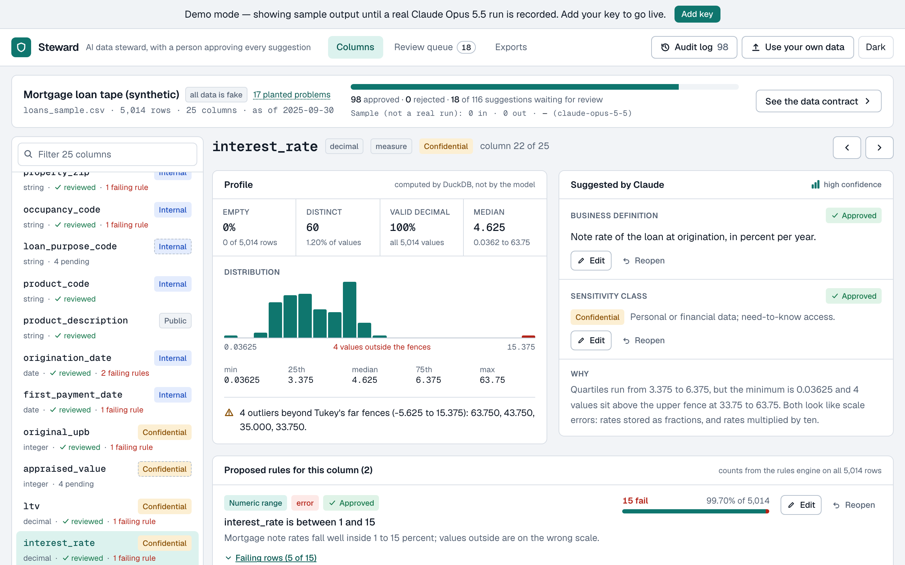
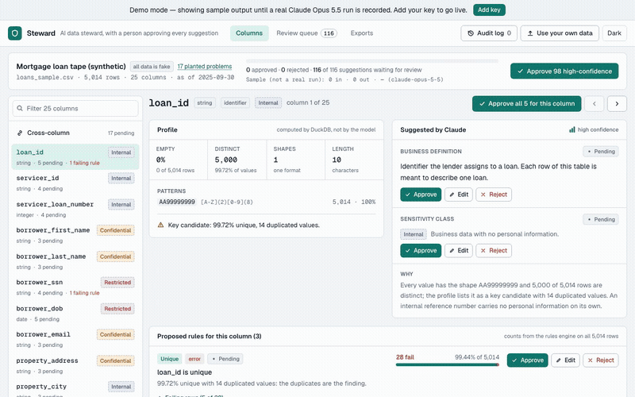
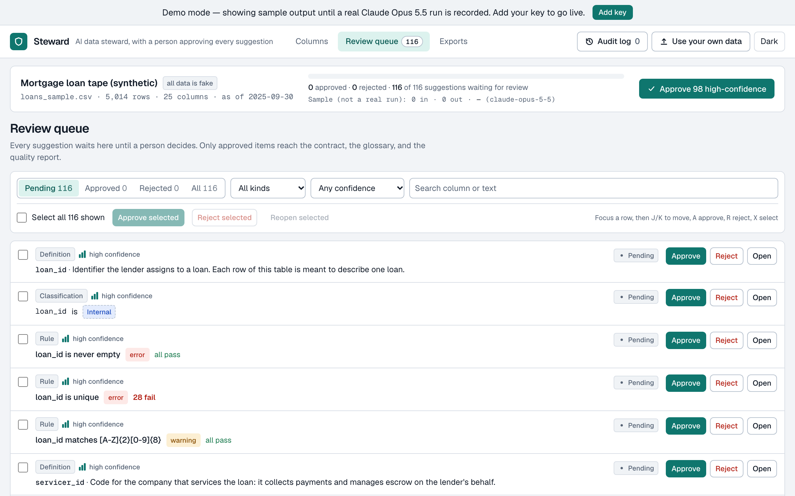
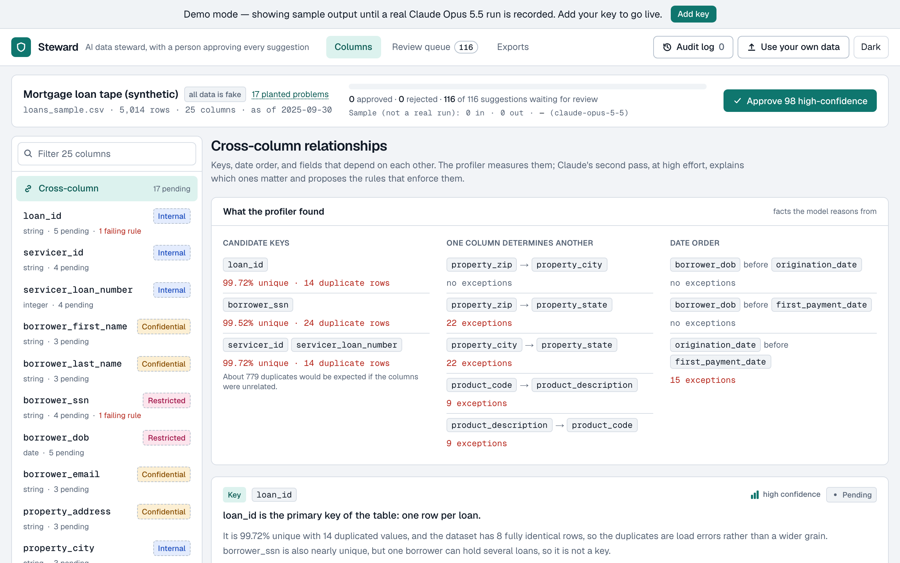
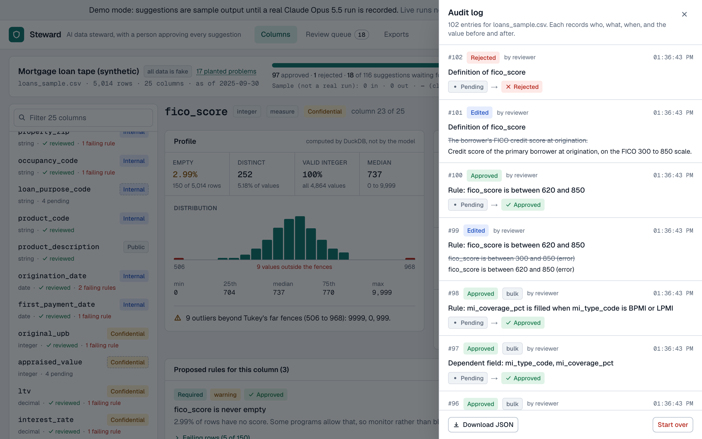
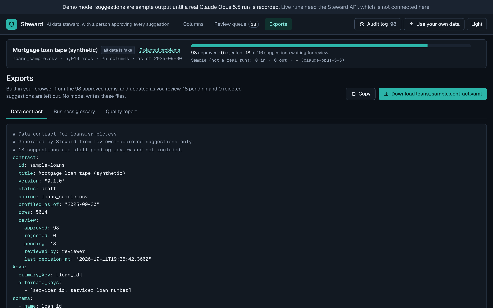
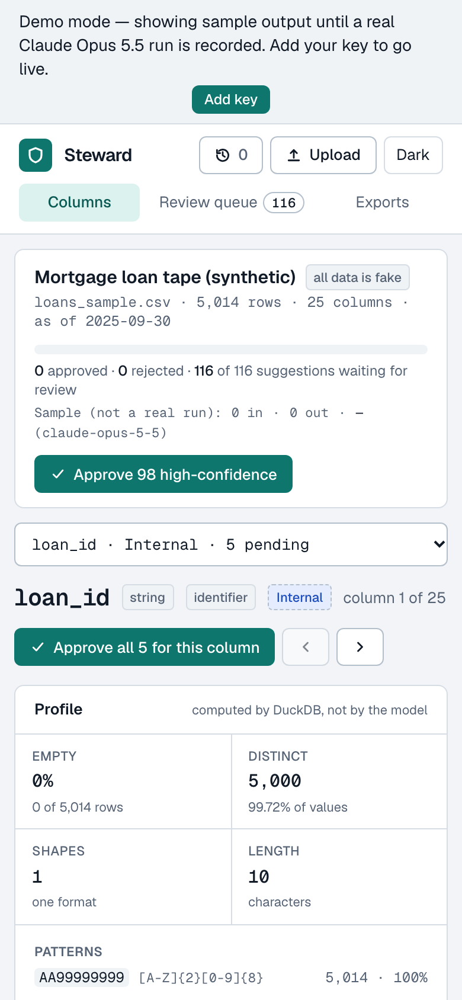
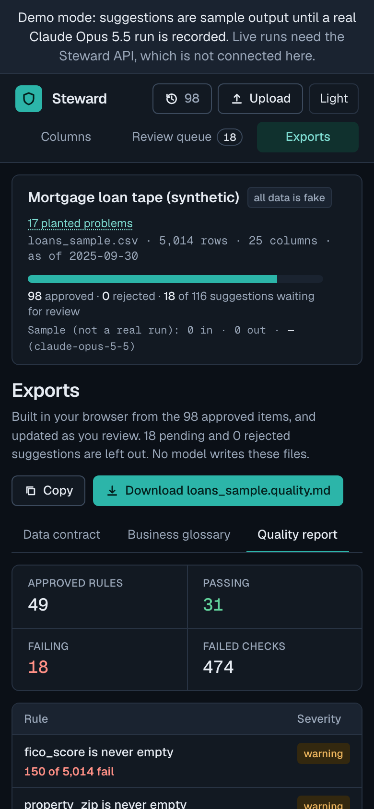
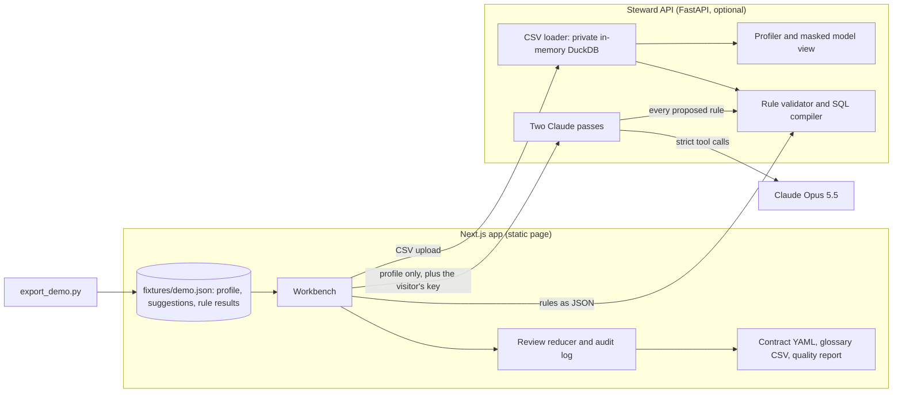

# Steward

> An AI data steward. Drop in a dataset and it profiles every column, drafts the catalog, classifies sensitive fields, proposes data-quality rules, and writes a data contract, with a person approving every suggestion.

[](https://github.com/davezagin-max/steward/actions/workflows/ci.yml)
[](LICENSE)
[](https://steward.vercel.app)



## Try it in 10 seconds

**[Open the live demo](https://steward.vercel.app)**: no key, no sign-up. A synthetic mortgage loan tape (5,014 rows, 25 columns, 17 planted data problems) opens already profiled, with 116 suggestions waiting for review. Click **Approve 98 high-confidence**, then **See the data contract**. Open `interest_rate` to see a rule that fails 15 rows, with the rows.



Demo data in this commit is hand-written sample output; `pnpm record` replaces it with real Claude Opus 5.5 runs.

What that means exactly:

- **Computed for real:** every profile number and every pass/fail count. The DuckDB engine runs on the actual CSV, and the tests check its failing rows against the generator's list of planted problems, row for row.
- **Hand-written for now:** the suggestion text (definitions, sensitivity classes, proposed rules, rationales). It is written in the exact shape the model's tool calls return and goes through the same validator. The app labels it "sample", never "recorded".
- **Not yet run against the real API:** the live Claude path. It is complete and covered by tests with a scripted client at unit, HTTP, and browser level, but no API key existed when this was built.

The whole sample runs in the browser from a bundled JSON file. Uploading your own CSV and running Claude live need the Python API (see "Run locally").

## Why it's interesting

- **The model never writes SQL.** It proposes rules as JSON from a closed catalog of 11 typed rules (`not_null`, `unique`, `in_set`, `range`, `regex`, `parses_as`, `date_not_future`, `date_order`, `conditional_not_null`, `reference_consistency`, `derived_ratio`). A validator rejects unknown types, unknown columns, extra fields, and out-of-bounds parameters. Only then does a compiler turn the rule into SQL: column names are checked against the dataset again and quoted, and every value is a bound parameter, regex patterns included. In the tool schema, column fields are an enum of the dataset's real column names, so the model cannot name a column that does not exist. The tests run every rule type against column names like `x"; DROP TABLE dataset; --`.
- **The model sees a profile, not rows.** Claude gets types, null rates, distinct counts, and value shapes (`LN40718236` becomes `AA99999999`). Columns whose name or values look personal lose every raw value, including minimum and maximum. Raw values are listed only for other columns with 60 or fewer distinct values, where the model needs the code list to propose an allowed set. Each column has a panel showing the exact JSON that is sent. This is the answer to "would you send customer data to an LLM?".
- **Code computes the facts; a person makes the decisions.** The profiler is deterministic SQL: types inferred from parse rates so bad values stay countable, Tukey far fences for outliers, keys that are still recognized when a few rows are duplicated, and composite keys reported only when their uniqueness is surprising given how many value combinations exist. Every suggestion lands in a review queue as pending. Approve, edit, reject, and reopen each append to an audit log with the value before and after. The contract, glossary, and quality report are pure functions of the approved items; no model writes them.

| | |
| --- | --- |
|  |  |
| Review queue: filters, bulk actions, keyboard shortcuts | Keys, dependencies, and date order, measured by the profiler |
|  |  |
| Audit log: who, what, when, before and after | Data contract YAML, built from approved items only |

<p>
  
  
</p>

## Architecture



Three stages, each with one job:

1. **Profile** (`server/app/dataset.py`, `profiler.py`). The CSV is loaded as text into a DuckDB that lives for one request. Headers are rewritten to plain identifiers, and once the table exists the connection loses file and network access. The profiler computes everything the UI and the model see.
2. **Suggest** (`server/app/assess.py`). Pass 1 asks Claude about one column at a time; pass 2 asks once about relationships across columns. Whatever comes back is normalized: rules go through the validator, and anything that fails is kept with the reason and shown as "blocked by the validator", never executed.
3. **Review and export** (`lib/steward/`). The review queue is a pure reducer in the browser. The exports are generated there from approved items.

The deployed site does not need the API. `server/scripts/export_demo.py` precomputes the profile, the suggestions, and the result of every suggested rule for the sample, and the Next.js app bundles that file. A test rebuilds the bundle and fails if the committed copy is stale.

| Path | What it holds |
| --- | --- |
| `server/app/rules.py` | The rule catalog, validator, SQL compiler, and engine |
| `server/app/profiler.py` | Type inference, shapes, outliers, keys, dependencies, and the masked view sent to the model |
| `server/app/assess.py` | Prompt, strict tool schemas, the two passes, and the normalizer |
| `server/app/claude_client.py` | The only code that calls the Anthropic SDK |
| `server/scripts/generate_sample.py` | Seeded generator for the loan tape and its manifest of planted problems |
| `lib/steward/review.ts` | Review queue reducer and audit log |
| `lib/steward/exports.ts` | Data contract, glossary, and quality report |
| `components/steward/` | The workbench UI |

`lib/claude.ts` and `lib/api.ts` come from the scaffold this portfolio shares. This app has no Next.js API routes, so they are not on its request path; the browser uses only their response types. They are kept with their tests.

## How it uses Claude Opus 5.5

| Feature | Why |
| --- | --- |
| Strict tool use: `record_column_assessment` and `record_relationships` | The output must match a JSON schema, including an enum of the real column names. It is still validated in code afterwards. |
| Effort tuned per step: `low` for the 25 per-column calls, `high` for the one cross-column call | Describing one column is routine and happens many times. Finding keys, dependencies, and derived fields needs reasoning across the whole profile, once. |
| Prompt caching of the profile | Both passes send the same system prompt (the masked profile) and the same tools, so the prefix is identical. The first call runs alone to write the cache; the other 25 read it. Cache-read tokens are shown per pass in the cost meter. |
| The tool call is checked, not assumed | Tool choice cannot be forced. A missing call, the wrong tool, or an answer for the wrong column gets one retry in the same conversation, with the failed call answered first. An answer cut off at the token limit is asked again from the start with more room. |
| Profile wrapped as untrusted data | Column names and code values come from an uploaded file. They sit inside a tagged block the prompt declares to be data, and a value cannot close the tag. |
| Refusals are results | A refusal on the first call ends the run with a clear message. A refusal on a later column is recorded for that column and the run continues. |

**Your key stays yours.** The app is bring-your-own-key. The key lives in your browser tab's memory (optionally `sessionStorage`), travels in an `x-anthropic-key` header to the Steward API, and is used for that one run. The server never stores or logs it. Each run shows its token count and cost. If you cancel, the server stops starting new calls; calls already in flight finish.

## Run locally

```bash
pnpm install
pnpm dev -p 3130
```

Open http://localhost:3130. The sample works with nothing else running.

To upload your own CSV, re-run edited rules, or run Claude with your key, start the API too (needs [uv](https://docs.astral.sh/uv/)):

```bash
cd server && uv sync && uv run uvicorn app.main:app --port 8130
NEXT_PUBLIC_API_URL=http://localhost:8130 pnpm dev -p 3130
```

## Tests & quality

```bash
pnpm check                                   # lint, typecheck, unit tests, production build
cd server && uv run pytest -q                # profiler, rules engine, Claude passes, API
pnpm e2e:live                                # the live path in a headless browser, no key needed
```

251 tests: 153 pytest and 98 Vitest (4 more are live smoke tests that skip without a key).

- **Rules engine.** Every rule type on a table with known answers. Hostile column names and injection strings as values across all 11 types. Values never appear in compiled SQL. The engine's failing rows equal the generator's manifest, row for row, for all 17 planted problems.
- **Profiler.** Type inference, leading-zero codes kept as text, quartiles and fences on known distributions, near keys, composite keys found and accidental ones not, dependencies with violation counts. For every reported shape, the regex beside it matches exactly the rows with that shape.
- **What the model sees.** No SSN, email, address, or date of birth from the CSV appears in the prompt. No character of a masked value survives in its shape, including accented, Cyrillic, and CJK text.
- **Claude passes** (scripted client): strict tools, effort per pass, one cache write and 25 cache reads, the retry paths, refusals, and stopping when the visitor cancels.
- **Review and exports.** The reducer and audit log, restoring a saved review from untrusted storage, and the YAML emitter round-tripped through a real YAML parser.
- **Fixtures.** Every fixture is re-run through the live normalizer and validator, and placeholders must be marked and claim zero usage.

CI runs the same checks plus a gitleaks secret scan on every push.

## Tradeoffs, limitations, next steps

- **The live Claude path has not met the real API.** The request shape follows the documented rules and is tested with a scripted client, but the strict tool schema has never been accepted or rejected by the service. It repeats the column-name enum in every rule branch (about 25,000 characters of tool definitions for the 25-column sample), so a very wide upload may hit a schema size limit.
- **Masking is a heuristic.** A column is masked when its name contains a known word (`ssn`, `dob`, `email`, a person-name pattern, and so on) or its values match an email, SSN, or phone pattern. A personal column with an unfamiliar header and 60 or fewer distinct values would have its values listed. The UI shows what would be sent before a run; a per-column "mask this" switch is the next step.
- **The rule catalog is closed on purpose,** so some real checks have no rule: numeric comparison between two columns, or a numeric condition such as "mortgage insurance is required when LTV is above 80". The sample records that relationship without a rule.
- **Only ISO dates (`YYYY-MM-DD`) are recognized as dates.** Other formats are profiled as text with shapes.
- **Outliers are a hint, not a control.** Tukey fences flag the four interest rates multiplied by ten but not the eleven entered as fractions, which sit inside the fences. The range rule catches both.
- **Key and dependency search is bounded:** composite keys up to three columns and 300 candidates, dependencies between categorical columns only.
- **No accounts.** The reviewer is a fixed name, and the audit log lives in the browser (saved on the device for the sample, in memory for an upload). A real deployment needs sign-in and a server-side log.
- **The API is stateless.** An uploaded CSV stays in browser memory and is sent again with each rule run, which is fine at the 5 MB cap and wrong beyond it.
- **A live run replaces the current suggestions** and their review; there is no merge.
- Rate limiting is in memory per server instance: enough to blunt abuse of a demo, not a global quota.
- **Cut:** column-level lineage from SQL (sqlglot and React Flow) was a stretch goal and was not started.

---

Built with Claude Code and Claude Opus 5.5.
